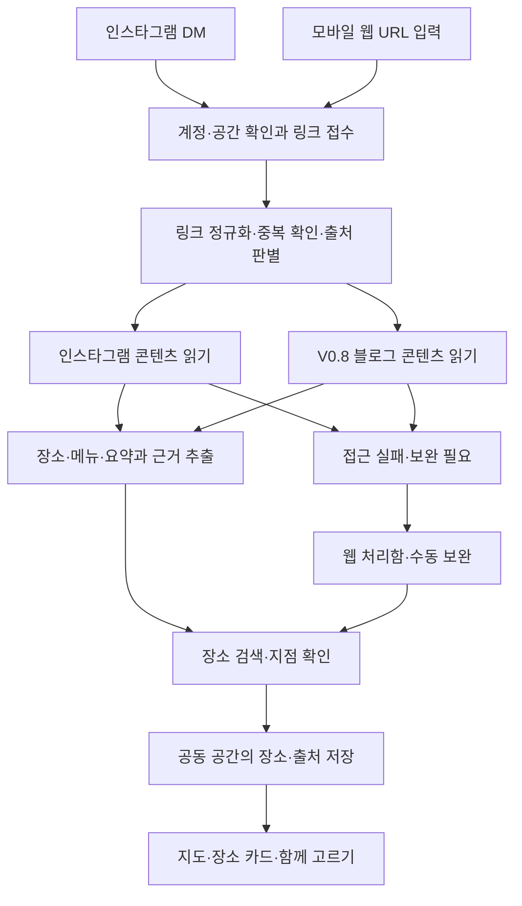

# 가자함 (Gajaham) — 커플 장소 보관·선택 서비스 기획서

> **서비스 계정에 DM으로 보내면, 둘이 가자고 했던 곳과 추천 메뉴가 지도에 모인다.**

| 항목 | 내용 |
|---|---|
| 문서 버전 | 0.2 — 서비스명·영문 표기 반영 |
| 작성일 | 2026-10-11 |
| 수정일 | 2026-10-12 |
| 서비스명 | 가자함 — 2026-10-12 확정 |
| 영문 표기 | Gajaham |
| 초기 고객 | 인스타그램으로 맛집·카페·놀거리 게시물을 자주 주고받는 커플 |
| 첫 제공 형태 | 인스타그램 서비스 계정으로 DM 수집 + 모바일 웹 |
| 첫 확장 | 블로그 URL을 같은 DM과 웹 입력으로 수집 |
| 현재 상태 | 시장조사와 제품 기획 완료 단계. 계정 연동·개발·실제 추출 실험·사용자 실험은 미실행 |
| 관련 문서 | [시장조사](./market-research-2026-10-10.md), [상세 버전 로드맵](./version-roadmap-2026-10-10.md) |

이 문서는 사용자가 요청한 기능과 출시를 위한 제안을 구분한다. 기능의 구현 가능성, 일정, 가격이 모두 확정됐다는 의미는 아니다. 기존 로드맵에서 V1.0에 제안한 ‘함께 고르기’ 중 수동 후보 선택을 초기 베타로 앞당긴다. 반복 사용 여부를 먼저 검증하기 위한 변경이며, 조건별 자동 추천은 V1.0 범위로 유지한다. 문서 간 출시 범위가 다를 때는 이 기획서를 기준으로 한다.

## 1. 제품 방향과 요구사항

### 1.1 해결할 문제

연인이 ‘여기 가자’며 공유한 게시물이 DM에 쌓여도, 실제 약속을 정할 때는 내용을 다시 찾고 상호명을 검색해야 한다. 장소를 찾은 뒤에도 어느 메뉴가 추천이었는지, 무엇 때문에 가고 싶었는지 기억하기 어렵다. 인스타그램과 블로그에 흩어진 정보를 같은 기준으로 비교하기도 번거롭다.

이 서비스는 **발견 → 전달 → 장소와 맥락 정리 → 함께 선택 → 방문**을 연결한다. 첫 사용에서는 저장하는 수고를 줄이고, 반복 사용에서는 두 사람이 갈 곳을 정하는 수고를 줄이는 것이 목표다.

### 1.2 사용자 요구와 제안의 구분

| 구분 | 내용 |
|---|---|
| 확정 사항 | 서비스명은 ‘가자함’, 영문 표기는 ‘Gajaham’으로 사용한다. |
| 사용자 요구 | 인스타그램에서 DM을 보내듯 전달하여 수집을 시작한다. |
| 사용자 요구 | 맛집·카페·놀거리를 한눈에 보고, 링크에서 위치를 찾아 지도에 핀으로 표시한다. |
| 사용자 요구 | 게시물의 내용과 추천 메뉴를 스냅샷 형태로 이해할 수 있게 자동 정리한다. |
| 사용자 요구 | 연인과 공유한 장소를 함께 관리한다. |
| 사용자 요구 | 이후 블로그 링크 전달도 추가할 수 있어야 한다. |
| 기획 제안 | 초기에는 국내 장소와 2인 비공개 공간에 집중한다. |
| 기획 제안 | 앱 설치 없이 DM으로 수집하고 모바일 웹에서 조회·수정·선택한다. |
| 기획 제안 | 장소를 저장한 뒤 주말 후보를 함께 고르는 기능을 초기 베타에서 검증한다. |
| 검증 필요 | Meta 계정·권한 설정, DM 수신·회신, 콘텐츠 접근 범위, 장소·메뉴 추출 품질, 사용자 재방문과 결제 의사 |

### 1.3 초기 고객

나이보다 행동을 기준으로 모집한다. 장소 게시물을 일주일에 여러 번 주고받고, 정기적으로 외출하며, 약속을 정할 때 예전에 보낸 링크를 다시 찾는 커플을 우선 대상으로 한다. 첫 베타는 한 생활권을 중심으로 운영해 장소 정확도와 사용 상황을 관찰한다. 전국 지원은 검증 결과를 보고 넓힌다.

주로 한 사람이 장소를 발견해 보내는 커플도 포함한다. 한 명이 먼저 저장해도 바로 가치가 있어야 하며, 상대방의 가입과 DM 연결을 첫 저장의 필수 조건으로 두지 않는다.

### 1.4 서비스명과 표기 기준

**가자함 (Gajaham)**은 ‘여기 가자’의 **가자**와 공유한 장소를 담는 ‘보관함’의 **함**을 결합한 이름이다. 연인과 가고 싶은 곳을 모으고 다시 꺼내 보는 경험을 담는다. 인스타그램뿐 아니라 블로그 등으로 출처를 확장해도 같은 이름을 사용한다.

- 한글 표기: **가자함** — 띄어쓰기 없이 사용한다.
- 영문 표기: **Gajaham** — 첫 글자만 대문자로 쓰며, 한 단어로 표기한다.
- 한글·영문 병기: **가자함 (Gajaham)** — 문서 제목과 첫 소개에 사용한다.
- 소개 문구 제안: **“우리 가자고 했던 곳, 가자함에.”**

## 2. 시장성과 진입 가설

### 2.1 확인한 사실

| 근거 | 기획상 의미 | 해석의 한계 |
|---|---|---|
| 한경닷컴·캐치의 2026년 5월 20대 1,060명 조사에서 23%가 SNS·숏폼으로 장소를 발견한 뒤 지도 앱에서 확인한다고 응답 [S1] | SNS에서 발견한 장소를 지도로 옮기는 흐름이 존재한다. | 커플 서비스 이용 의향이나 결제 의향을 조사한 결과는 아니다. |
| 쏙핀은 인스타그램 장소 저장과 연인·친구 간 공동 관리를 안내 [S2] | 장소 자동 저장과 공동 지도는 이미 경쟁 기능이다. | 공식 소개 기준이며 실제 추출 품질은 비교하지 않았다. |
| Bucket은 서비스 계정에 릴스를 DM으로 보내 정리하는 흐름을 안내 [S3] | DM 수집 경험에도 선행 제품이 있다. | 한국어 품질, 커플 공간, 실제 처리 안정성은 미검증이다. |
| 가볼지도는 인스타·네이버 블로그·유튜브 링크와 공동 지도 편집을 명시 [S4] | 블로그 지원도 경쟁사에 없는 기능이라고 주장할 수 없다. | DM 수신과 추천 메뉴의 근거 추출은 확인하지 못했다. |
| Places는 무료 요금제에 월 20회 가져오기와 공동 작업을 포함 [S5] | 기본 저장에 대한 유료화는 무료 대안과 비교된다. | 무료 사용량과 유료 전환 실적은 공개 자료에서 확인하지 못했다. |
| 냠고는 7일 체험 후 월 2,900원·연 29,000원을 안내 [S6] | 인접 서비스에서 유료 요금제를 시도하고 있다. | 실제 결제 규모와 수익성을 입증하지 않는다. |

출처는 문서 말미에 기재했다. 경쟁 기능과 가격은 2026-10-10~11에 확인한 사업자 공개 자료 기준이다. 설치·결제·실사용 비교는 수행하지 않았다. 자세한 비교는 시장조사 문서를 참고한다.

### 2.2 사업 판단

작은 베타를 출시해 검증할 가치는 있다. 현재 확인한 자료만으로 국내 전체 시장 규모, 예상 점유율, 성공 확률, 유료 고객 수를 산정하지 않는다. 다음 세 가지를 경쟁 제품과 같은 사용자 과제로 비교한다.

1. **전달의 편의성:** 인스타그램 안에서 보내는 행동만으로 저장이 시작되는가.
2. **다시 이해하기 쉬운 정보:** 원본 영상을 다시 보지 않고도 추천 메뉴와 저장 이유를 찾을 수 있는가.
3. **주말마다 쓰는 공동 선택:** 저장한 장소가 실제 약속을 결정하는 데 쓰이는가.

이 기능들의 조합과 품질이 차별화 가설이다. 각각의 기능이 시장에서 독점적이라는 의미는 아니다. 국내 지점 정확도, 출처가 있는 정보, 쉬운 수정과 반복 사용 경험을 먼저 개선한다.

## 3. 핵심 사용 시나리오

### 3.1 첫 DM과 개인 저장

1. 사용자가 인스타그램 게시물·릴스의 공유 메뉴에서 서비스 계정을 선택해 보낸다.
2. 서비스는 처리 가능한 입력인지 확인하고 링크를 접수한다. 첫 이용이라면 모바일 웹 연결 안내를 제공한다.
3. 사용자는 자신의 연결 요청을 확인하고 비공개 공간을 만든다. 연결 전 입력은 다른 사람에게 보이지 않는 임시 접수 상태로 둔다.
4. 분석 결과에서 장소가 확인되면 지도에 핀을 표시한다. 위치가 불분명하면 목록의 ‘확인 필요’에 보관한다.
5. 사용자는 결과 링크를 열어 장소·메뉴·원본을 확인한다. DM 회신은 플랫폼이 허용하는 범위에서 수행하고, 처리 상태는 웹에서도 확인할 수 있게 한다.

서비스는 ‘접수 완료’와 ‘장소 저장 완료’를 구분한다. 링크를 받았다는 이유만으로 지도 저장에 성공했다고 알리지 않는다.

### 3.2 두 사람이 같은 공간 사용

1. 먼저 이용한 사람이 공간의 초대 링크를 연인에게 전달한다.
2. 상대방은 모바일 웹에서 초대를 수락해 같은 공간에 참여한다. 설치는 요구하지 않는다.
3. 상대방도 DM으로 저장하려면 서비스 계정에 직접 메시지를 보내 자신의 계정을 연결한다.
4. 두 사람이 각각 전달한 장소가 같은 지도에 모이고, 보낸 사람과 원본 출처는 구분된다.

초대 링크는 참여를 허가하기 위한 링크다. 전달만으로 공간의 전체 기록이 공개되지는 않으며 만료·취소가 가능해야 한다. 연결 확인은 만료되는 일회용 토큰 등으로 검증하고, 타인의 인스타그램 아이디 입력만으로 연결하지 않는다.

**기존 연인 간 개인 DM 전체 읽기, 과거 대화 자동 가져오기, 커플 그룹 DM에 봇을 넣는 방식은 초기 범위에 포함하지 않는다.** 서비스 계정에 각자가 개별 전달하는 흐름을 검증한다. Meta의 공식 메시징 문서는 프로 계정 중심이며, 공유 게시물 URL 수신과 그 콘텐츠 전체 접근은 별도 문제다. [S7]

### 3.3 주말에 장소 고르기

1. 두 사람이 저장한 장소를 지도나 목록에서 다시 연다.
2. 각자 ‘가고 싶어’를 표시하고 이번 약속 후보를 최대 3곳까지 고른다.
3. 장소 카드에서 위치, 게시물 추천 메뉴, 각자의 메모를 비교한다.
4. 최종 장소를 하나 선택하고 지도 앱의 길찾기로 이동한다.
5. 방문 후 ‘다녀왔어요’를 표시한다.

초기 베타에서는 수동 후보 선택으로 시작한다. 지역·예산·시간에 따른 자동 후보 추천은 V1.0에서 확장한다.

### 3.4 블로그 링크 추가

V0.8부터 지원하는 블로그 URL을 같은 서비스 계정의 DM으로 보내거나 웹에 붙여넣는다. 기존 장소와 같은 지점이면 새 핀을 만드는 대신 참고 글을 추가한다. 장소를 특정할 수 없거나 읽을 수 없는 글은 링크를 남기고 보완 입력을 요청한다.

## 4. 첫 베타의 범위

첫 외부 베타의 제품 범위는 **V0.1의 DM·지도 기능 + V0.5의 기본 카드 + 최소 공동 선택**으로 정의한다. 공개 가입을 넓히기 전에도 베타 참여자 간 데이터 분리와 공유 해제는 갖춰야 한다.

| 우선순위 | 기능 | 첫 베타에서의 완료 조건 |
|---|---|---|
| P0 | DM 수신·계정 연결 | 허용된 입력을 해당 사용자의 공간에 연결하고 접수 상태를 확인할 수 있다. |
| P0 | 웹 URL 입력 | DM 처리에 문제가 있거나 링크를 복사한 경우 웹에서도 접수할 수 있다. |
| P0 | 장소 추출·검색 보정 | 장소명·지점을 찾고, 불확실하면 사용자가 후보를 고르거나 검색해 수정한다. |
| P0 | 지도·목록 | 확정된 위치만 핀으로 표시하고 미확정 항목도 목록에서 찾을 수 있다. |
| P0 | 장소 카드 | 확보한 정보로 소개·메뉴·원본·보낸 사람을 표시한다. 근거가 없는 필드는 비워 둔다. |
| P0 | 이미지 없는 카드 | 썸네일을 확보하지 못해도 텍스트 카드와 원본 링크로 이용할 수 있다. |
| P0 | 2인 비공개 공간 | 초대·수락·취소·나가기와 접근 권한 검증이 동작한다. |
| P0 | 수정·중복 처리 | 사용자 수정이 보존되고 같은 링크를 다시 보내도 같은 카드가 불필요하게 늘지 않는다. |
| P0 | 함께 고르기 | 개인 관심 표시, 수동 후보 최대 3곳, 최종 선택을 제공한다. |
| P0 | 기본 기록 관리 | 방문 표시, 저장 항목 삭제·휴지통 복구, 구조화된 기록 내보내기를 제공한다. |
| P0 | 실패 처리·계측 | 실패를 알리고 보완·재시도를 제공하며 성공률과 오류 종류를 집계한다. |
| P1 | 한 게시물의 여러 장소 분리 | 확인된 장소별로 카드를 만들고 미확정 항목을 별도로 표시한다. |
| P1 | 상세 카드 보강 | 확보 가능한 이미지·OCR·추천 이유·방문 팁과 필드별 출처를 보강한다. |
| P1 | 선택 조건 보강 | 지역·예산·시간 조건으로 후보를 좁힌다. |
| P2 | 블로그 분석·데이트 코스·취향 추천 | 버전별 검증을 통과한 순서로 추가한다. |

첫 베타에서 여러 장소 자동 분리가 미완성이라면 한 장소만 조용히 저장하고 완료로 표시하지 않는다. ‘여러 장소 확인 필요’를 알리고 장소를 추가할 수 있게 한다. P1의 우선순위와 무관하게 실패를 숨기지 않는 동작은 P0이다.

초기 범위에서 제외하는 기능은 네이티브 앱, 공개 추천 피드, 상점 광고 상품, 직접 예약·결제 대행, 해외 장소 확대, 긴 영상의 무조건적인 전체 분석이다. 블로그는 확정된 확장 요구이며 초기부터 데이터 구조에 반영한다.

## 5. 화면 구성

| 화면 | 핵심 내용 | 주요 행동·빈 상태 |
|---|---|---|
| 시작·공간 연결 | 서비스 설명, DM 연결, 공간 만들기·초대 수락 | 첫 링크 저장, 인스타 연결. 상대방이 없어도 개인 저장 시작 |
| 우리 지도·목록 | 지도/목록 전환, 맛집·카페·놀거리, 지역·장소명 검색, 방문 여부, 보낸 사람 | 카드 열기, 필터. 저장 항목이 없으면 DM 보내기 안내 |
| 처리함 | 분석 중·확인 필요·실패 항목과 원본 | 장소 선택, 본문·캡처 보완, 재시도, 삭제 |
| 장소 상세 | 대표 이미지 또는 대체 카드, 장소·지점·주소, 요약, 메뉴, 출처, 메모, 관심·방문 상태 | 위치 수정, 후보 추가, 원본 열기, 길찾기 |
| 이번 약속 | 최대 3개 후보, 두 사람의 관심, 비교 정보, 확정한 장소 | 후보 교체, 최종 선택, 선택 변경 |
| 공간·설정 | 구성원, 초대 상태, DM 연결, 데이터 내보내기, 공유 종료·탈퇴 | 초대 취소, 연결 해제, 공간 나가기, 기록 삭제 |

모바일에서는 지도 핀을 누르면 하단에 카드 요약을 열고, 상세 내용은 별도 화면에서 읽는다. 지도 로딩에 문제가 있어도 목록과 원본 링크는 열 수 있게 한다. 미확정 장소는 임의 좌표에 핀을 만들지 않는다.

### 5.1 장소 카드 예시

아래는 실제 가게 정보가 아닌 화면 구성 예시다.

> **예시 카페 · 성수점**  
> 카페 · 서울 성동구 · 위치 확인됨  
> ‘테라스 분위기와 피스타치오 음료를 소개한 게시물’  
> **게시물 추천 메뉴:** 피스타치오 라테 — 원문 추천 표현 확인  
> **방문 팁:** 주말 대기 언급 — 게시물 작성자의 경험  
> **우리 메모:** 서울숲 산책하고 가기  
> **출처:** 인스타 게시물 1개 · 보낸 사람 A · 저장 날짜  
> **행동:** 가고 싶어 / 이번 약속 후보 / 위치 수정 / 원본 / 길찾기

### 5.2 스냅샷의 정의

첫 제품의 스냅샷은 **장소와 게시물 내용을 빠르게 기억할 수 있는 정보 카드**다. 확보 가능한 대표 이미지·요약·메뉴·출처를 묶고, 자동 이미지 확보가 어려우면 사용자 캡처와 텍스트 카드로 보완한다.

원본 임베드, 썸네일 표시, 서버에 보존한 화면 캡처는 다른 기능이다. 원본 게시물의 영구 복제나 삭제 후 재생 가능성을 약속하지 않는다. 원문 접근이 사라지면 이를 알리고, 서비스에 이미 저장된 정보 중 보관 가능한 범위와 사용자가 직접 남긴 메모를 유지한다. 자동 캡처의 접근·저장 방식은 V0에서 별도로 검토한다.

## 6. 정보 품질과 처리 규칙

### 6.1 추출할 정보

| 정보 | 표시·저장 원칙 |
|---|---|
| 장소명·지점·주소·좌표 | 원문 단서와 장소 검색 결과를 대조한다. 지점이 모호하면 확인 필요로 둔다. |
| 카테고리 | 맛집·카페·놀거리를 기본으로 하고 사용자가 변경할 수 있다. |
| 한 줄 소개 | 확보한 원문 내용을 요약한다. 원문에 없는 특징을 추가하지 않는다. |
| 메뉴 | 단순 등장한 메뉴와 작성자가 추천한 메뉴를 구분한다. 추천 근거가 없으면 ‘언급 메뉴’로 표시한다. |
| 추천 이유·방문 팁 | 게시물 작성자의 표현·경험임을 표시하고 출처를 연결한다. |
| 가격·영업시간·행사 기간 | 원문에 있을 때 출처와 시점을 함께 저장한다. 최신 운영 정보로 단정하지 않는다. |
| 대표 이미지 | 확보와 표시가 가능한 이미지 또는 사용자가 올린 캡처를 이용한다. 없는 경우 대체 카드 표시 |
| 사용자 메모·수정 | 자동 추출 정보와 분리하며 이후 재분석으로 덮어쓰지 않는다. |

필드별로 원본 URL, 가능한 범위의 게시일, 가져온 시각, 근거 위치 또는 짧은 근거 구간, 자동 추출/사용자 입력 여부를 관리한다. 가격이 서로 다른 글은 한 값을 임의로 최신 정보로 합치지 않고 출처별로 보여준다. ‘위치 확인됨’과 ‘가격·영업시간 최신 확인’도 구분한다.

### 6.2 처리 상태

기본 흐름은 `접수 → 연결 대기 또는 분석 중 → 저장 완료 / 일부 완료 / 확인 필요 / 분석 실패`다. 사용자가 보완하면 다시 분석하거나 직접 저장할 수 있다.

| 상황 | 사용자에게 보일 결과 | 시스템 동작 |
|---|---|---|
| 링크를 받았지만 계정 연결 전 | 연결 안내 | 임시 접수로 유지하고 공간 연결 후 처리 |
| 콘텐츠를 읽을 수 없음 | 링크 보관, 본문·캡처 또는 장소 검색 안내 | 접근 실패를 기록하고 장소·메뉴를 추측하지 않음 |
| 동명 가게·지점 불명확 | 후보 장소와 차이를 표시 | 선택 전까지 핀 확정 보류 |
| 장소는 찾았지만 메뉴 근거 없음 | 메뉴 정보 없음 | 장소 저장을 완료하되 메뉴를 생성하지 않음 |
| 여러 장소 중 일부만 확인 | 일부 완료와 미확정 목록 | 확인된 장소만 핀 표시, 나머지는 보완 가능 |
| 같은 링크 재전달 | 기존 카드로 이동 | 중복 카드 생성 없이 새 전달 기록만 연결 |
| 다른 글이 같은 지점을 소개 | 기존 장소에 새 출처 표시 | 출처 추가, 사용자 메모 보존 |
| 장소 없는 게시물 | 장소 정보 확인 필요 | 링크로 보관하고 수동 장소 연결 제공 |
| 아직 지원하지 않는 블로그 | 분석 미지원 안내와 원본 링크 | 접수와 분석 지원 여부를 구분 |
| 처리 지연 또는 회신 제한 | 웹 처리함에서 상태 확인 | 회신 가능한 범위에서만 DM 응답, 작업 중복 방지 |

재전송·재시도·수신 이벤트 중복이 같은 카드의 중복 생성으로 이어지지 않게 한다. 실패 항목도 성공률 계산의 분모에 포함한다. 외부 콘텐츠에 포함된 지시문은 실행 지시가 아니라 분석할 자료로만 다룬다.

## 7. 확장 가능한 구조

### 7.1 입력 경로와 콘텐츠 출처 분리

DM은 받는 경로이고, 인스타그램 게시물과 블로그는 읽는 대상이다. 블로그가 추가되어도 계정·공동 공간·지도·후보 선택을 새로 만들지 않도록 공통 저장 형식을 사용한다. 향후 앱 공유나 다른 입력 경로도 같은 접수 단계에 연결한다.

### 7.2 핵심 데이터

| 단위 | 주요 정보 | 필요한 이유 |
|---|---|---|
| 사용자·연결 계정 | 내부 사용자, 검증된 인스타 계정 연결 상태 | DM 발신자와 서비스 사용자 연결 |
| 공간·참여자 | 비공개 공간, 최대 2명, 권한·초대 상태 | 커플 간 데이터 분리와 공유 종료 |
| 수신·처리 작업 | 발신자, 수신 경로, 원본·정규화 URL, 처리 상태, 실패 이유 | 중복 방지·재시도·품질 측정 |
| 참고 콘텐츠 | 출처 종류, URL, 게시일·수집일, 확보한 본문·이미지 정보 | 인스타와 블로그를 같은 장소에 연결 |
| 장소 | 지도 제공자 장소 식별자, 이름·지점·주소·좌표 | 동일 지점 판별과 위치 수정 |
| 공간의 저장 장소 | 공간, 장소, 저장자, 카테고리·메모·방문 상태 | 공용 장소 정보와 커플의 사적 기록 분리 |
| 콘텐츠-장소 연결 | 하나의 글과 그 글에 등장한 여러 장소 | 한 글의 여러 장소, 한 장소의 여러 글 지원 |
| 추출 정보·수정 정보 | 메뉴·팁·요약, 근거, 시점, 사용자 수정 | 근거 확인·충돌 처리·수정 보존 |
| 관심·약속 | 각자의 관심, 후보, 최종 선택, 선택 시각 | 실제 공동 선택과 재사용 측정 |

콘텐츠 URL은 원본을 보존하면서 비교용 URL을 별도로 둔다. 쿼리 문자열을 무조건 삭제하지 않고 출처별 규칙을 적용한다. 서로 다른 지점은 별도 장소로 유지한다. 비공개 메모·관심·공유 기록은 공통 장소 데이터에 합치지 않는다.

### 7.3 아직 확정하지 않은 기술 선택

프론트엔드·서버·데이터베이스·AI 모델·지도 제공자는 V0 결과와 운영비를 확인한 뒤 선택한다. 지도 및 장소 검색은 국내 지점 품질, 길찾기 연결, 호출 비용, 이용 조건을 비교한다. 긴 작업은 접수와 분리해 비동기로 처리하고, 상태 확인·재시도·비용 집계가 가능하게 한다.

Meta 공식 API의 실제 권한, 계정 심사와 운영 범위, 회신 규칙을 확인해야 한다. URL을 받을 수 있다는 사실만으로 본문·영상·이미지를 모두 확보할 수 있다고 가정하지 않는다. [S7]

## 8. 공동 공간과 기록 관리

- 첫 사용자는 혼자 저장할 수 있다. 두 번째 참여자가 들어오면 같은 공간을 함께 사용한다. 첫 버전은 사용자당 활성 공간 1개를 기본안으로 한다.
- 두 참여자는 공간의 장소를 추가·수정·삭제할 수 있다. 관심 표시는 각자 관리하고, 수정·삭제 주체를 기록한다.
- 일반 항목 삭제는 휴지통에서 복구 가능하게 한다. 영구 삭제와 계정 탈퇴는 일반 항목 삭제와 구분한다. 구체적 보관 기간은 베타 데이터 수집 전에 정해 안내한다.
- 공간의 공동 기록과 각자의 계정 연결은 분리한다. 한 사람이 나가거나 연결을 해제해도 다른 사람의 계정은 변경하지 않는다.
- 나가기는 본인의 공간 접근을 종료하며, 탈퇴 후 새 활동은 볼 수 없다. 남은 사람의 공유 기록을 임의로 모두 삭제하지 않도록 공유 종료 화면에서 남는 정보와 삭제되는 정보를 설명한다.
- 초대는 취소·만료·사용 완료 상태를 갖는다. DM 결과 링크도 접근 권한을 검증하며 URL을 아는 것만으로 다른 공간의 기록을 볼 수 없어야 한다.
- 기록 내보내기는 장소명·주소·메모·원본 URL·상태 등 구조화된 정보부터 제공한다. 외부 원본 미디어의 다운로드·영구 보관을 포함한다고 약속하지 않는다.

실제 베타 참가자 데이터의 수집 전에 초대·공유 종료·삭제·연결 해제를 검증한다. 콘텐츠 분석 실패의 진단에는 원문 전체를 불필요하게 장기 보관하지 않고 필요한 상태·오류 정보를 우선 사용한다.

## 9. 버전별 확장 계획

| 버전 | 목적 | 핵심 기능 | 다음 단계로 넘어갈 판단 |
|---|---|---|---|
| V0 — 가능성 검증 | DM 수집과 정확한 정리가 가능한지 확인 | API 연결·권한·회신, 실제 인스타 링크 30개, 장소·메뉴 근거, 접근 실패 대안 | 수신과 추출을 각각 검증하고 운영 가능한 처리 경로 확인 |
| V0.1 — 기본 저장 | 보낸 장소를 다시 찾기 | DM·웹 접수, 지도·목록, 기본 카드, 2인 공간, 수정·실패 처리 | 두 사람이 자신의 링크를 저장하고 다시 조회 가능 |
| V0.5 — 외부 베타 | 기억과 공동 선택의 가치 검증 | 카드 보강, 원본·근거, 중복 정리, 최소 공동 선택, 20커플 4주 실험 | 재사용·약속 결정·실제 결제 실험 결과로 계속/수정 판단 |
| V0.8 — 블로그 확장 | 다른 출처를 같은 지도에 모으기 | DM·웹의 블로그 URL, 출처별 읽기, 기존 장소에 출처 추가 | 지원 사이트별 품질·비용 확인, 인스타 처리 회귀 없음 |
| V1.0 — 함께 결정 | 저장한 곳에서 조건에 맞게 고르기 | 공통 관심·지역·예산·시간 필터, 후보 3곳과 이유 | 기존 DM+지도 방식보다 선택이 쉬워지고 반복 사용 유지 |
| V1.5 — 반나절 코스 | 고른 장소를 실행 가능한 순서로 묶기 | 2~4곳 코스, 이동·머무는 시간, 행사 기간, 일정 공유 | 큰 수정 없이 실제 방문에 사용되는지 확인 |
| V2.0 — 방문과 취향 | 방문 경험으로 다음 선택 개선 | 방문 사진·메뉴 평가, 재방문 의향, 저장 장소 재추천 | 입력 부담보다 다음 선택의 편익이 큰지 확인 |
| V3.0 — 운영 확장 | 더 많은 고객·출처·사용 상황 수용 | 운영 자동화, 지원 출처 확대, 유료 상품 고도화, 필요시 네이티브 앱 | 유지율·획득 비용·처리 원가가 지속 가능한지 확인 |

블로그는 반드시 수용할 확장 요구다. 네이버 블로그를 첫 검증 후보로 두고 티스토리·일반 블로그는 실제 요청과 처리 결과에 따라 추가한다. 모든 글의 접근 가능성을 약속하지 않는다. 단일 장소·복수 장소·사진 중심·오래된 글·읽기 불가 글과 모바일/공유 URL 중복을 출처별로 시험한다.

공개 출시와 과금은 V3.0에만 가능한 일이 아니다. 필요한 권한·운영·결제 준비가 갖춰지고 반복 사용이 확인되면 더 이른 버전에서도 확대할 수 있다. 반대로 일정에 맞추기 위해 품질이 부족한 상태로 확대하지 않는다. 실제 개발 기간과 예산은 V0 결과와 투입 인력을 확인한 뒤 산정한다.

## 10. 검증 계획과 출시 판단

### 10.1 V0: 실제 인스타 링크 30개

| 표본 | 수량 | 확인할 내용 |
|---|---:|---|
| 본문에 장소·주소가 있는 게시물 | 10 | URL 수신, 장소·지점 일치, 카드 완성 시간 |
| 이미지·영상에 핵심 정보가 있는 게시물 | 10 | 콘텐츠 확보, OCR 등 보완, 메뉴 근거, 접근 실패 |
| 복수 장소·체인 지점·행사 게시물 | 10 | 누락·오매칭, 기간 정보, 부분 완료와 수정 |

정답은 원문과 장소 정보를 사람이 확인해 기록한다. 자동 결과와 수동 보정 결과를 따로 집계한다. 같은 링크를 경쟁 서비스에도 넣어 저장 시간·수정 부담·카드의 유용성을 비교한다. 공개 소개만으로 경쟁 제품보다 낫다고 판단하지 않는다.

임시 통과 목표는 **30개 중 24개 이상에서 수동 보정 없이 유용한 카드 생성**이다. 유용한 카드는 올바른 지점·원본 연결·읽을 수 있는 설명이 있고, 원문에 없는 메뉴·가격을 생성하지 않은 카드다. 메뉴 정보가 없는 게시물은 빈 메뉴 필드로 완료할 수 있다. 복수 장소는 지원 범위를 사전에 정하고 일부 결과를 전체 성공으로 세지 않는다.

24/30은 업계 기준이 아닌 내부 가설이다. 잘못된 지점을 확정하거나 메뉴를 지어낸 건수는 완성률과 별도로 집계한다. 발견한 오류 원인을 해결·재검증하기 전에는 같은 유형에 대한 자동 완료 약속을 확대하지 않는다. 30개 통과는 품질 보증이 아니며 베타에서 새로운 입력을 계속 관찰한다.

### 10.2 V0.5: 20커플, 4주 베타

기존에 장소 게시물을 주고받는 커플을 모집하고 지인 외 참가자도 포함한다. 첫 주 이전에 기존 DM+지도 방식으로 장소를 고르는 과제를 관찰한다. 수작업 보정이 개입한 경우 자동 분석 성공으로 계산하지 않는다.

| 질문 | 측정 정의 | 초기 판단 기준 예시 |
|---|---|---|
| 첫 가치를 경험했나? | 첫 7일 내 3개 이상 저장하고 다른 세션에서 카드 또는 지도를 다시 연 커플 | 20커플 중 12커플 이상 |
| 네 번째 주에도 실제로 쓰나? | 4주 차에 저장한 장소로 약속을 확정하고 참가자가 실제 결정에 사용했다고 확인한 커플 | 최초 모집 20커플 중 8커플 이상 |
| 체험 후 돈을 내나? | 가격·조건을 알고 자발적으로 실제 결제한 커플 | 체험 후 20커플 중 5커플 이상이 월 3,000원 결제 |

모든 기준은 작은 베타에서 다음 투자를 판단하기 위한 제안이다. 업계 평균이나 예상 전환율이 아니며 모집 방식에 따른 편향이 있다. 중도 이탈을 분모에서 빼지 않는다. 단순 클릭만으로 방문·실제 약속 결정을 단정하지 않는다. 결제 실험은 해당 가격의 서비스를 제공할 준비가 된 경우에 수행하고, 다음 달 유지 여부까지 별도로 확인한다.

주요 보조 지표는 다음과 같다.

- 두 사람 모두 저장 또는 선택에 참여한 커플 수, 한 사람만 활용한 커플 수.
- 올바른 지점 비율, 잘못 확정한 지점 수, 근거 없는 메뉴 수, 수동 수정 횟수.
- 원본을 다시 보지 않고 메뉴·저장 이유를 찾은 과제 수와 장소 결정 소요 시간.
- 처리 시간의 중앙값·느린 구간, 출처별 실패 이유, 재시도 비율.
- 성공한 저장 1건당 비용과 활성 커플당 월 처리·지원 비용.
- 최초 유입 경로, 초대 수락 여부, 중도 이탈 이유.

### 10.3 결과에 따른 결정

| 관찰 결과 | 다음 행동 |
|---|---|
| 정확도·반복 사용·실제 결제가 함께 나타남 | 베타 규모를 단계적으로 늘리고 블로그 및 조건별 선택을 검증 |
| 저장은 많지만 4주 차에 다시 쓰지 않음 | 코스·취향 기능을 늘리기 전에 다시 찾기와 약속 선택 흐름 수정 |
| 혼자서는 계속 쓰지만 상대방 참여가 낮음 | 커플 가입 마찰과 공동 기능의 필요성을 분리해 확인 |
| 반복 사용은 있지만 결제가 거의 없음 | 기본 가치와 과금 범위 재검토, 분석량 상품 등 다른 과금 가설 시험 |
| 수동 수정·지원 비용이 높음 | 지원 콘텐츠 범위를 좁히고 추출·장소 확인 품질 개선 |
| 공식 경로의 DM·콘텐츠 확보가 충분히 동작하지 않음 | 웹 입력·사용자 보완의 수용성을 확인하고 핵심 DM 약속의 실현 여부 재판단 |

## 11. 수익 모델과 비용

### 11.1 가격은 검증 가설

초기에는 한 커플이 함께 쓰는 요금제를 우선 시험한다. 월 3,000원은 베타의 실제 결제를 확인하기 위한 가격 가설이며 정식 가격은 아니다. 구독과 분석량 추가 구매를 비교하고, 무료 범위는 실제 처리량·원가를 측정한 뒤 정한다. 단순 설문에서 ‘낼 것 같다’는 답과 결제는 구분한다.

기록 조회·수정·내보내기는 과금 변경 후에도 사용자가 자신의 기록을 다룰 수 있도록 설계한다. 추가 분석량, 여러 출처 정리, 고급 계획 중 반복적으로 쓰는 기능에 지불 의사가 있는지 확인한다. 광고·예약 제휴 수익은 초기 사업성 계산에 넣지 않는다.

### 11.2 예시 매출과 손익

**가정:** 월 3,000원 × 유료 1,000커플 = 월 결제액 300만 원. 이는 고객 수 예측이나 순이익이 아니다. 결제 수수료·세금·환불·AI·장소 검색·지도·저장·서버·고객 지원·고객 확보 비용을 반영해야 한다.

원가는 성공한 요청만 보지 않는다. 콘텐츠 읽기 실패, 재시도, 이미지·영상 처리, 무료 이용자의 사용량과 수동 지원도 포함한다.

| 비용 단위 | 측정할 내용 |
|---|---|
| 제출 링크 1건 | 콘텐츠 접근, 분석, 장소 검색, 실패·재시도 포함 비용 |
| 유용한 저장 1건 | 전체 처리 비용 ÷ 유용하게 저장한 건수 |
| 활성 커플 1쌍 | 월 분석량, 조회량, 저장량, 지원 시간과 배분 비용 |
| 유료 커플 1쌍 | 실수령액에서 처리·지원 비용을 제외한 기여 금액 |
| 유료 고객 확보 | 유입 비용 ÷ 실제 신규 결제 커플 수, 이후 유지 기간 |

작은 수익 사업과 여러 명의 팀을 운영할 사업은 필요한 고객 규모가 다르다. 가격표의 존재만으로 수익성을 판단하지 않으며, 초기 유지 기간이 짧을 때 장기 고객 가치를 과도하게 추정하지 않는다.

## 12. 초기 고객 확보

첫 메시지는 ‘AI 지도’보다 사용자가 겪는 상황을 보여준다. 예시 문구는 **“우리 DM에 묻힌 ‘여기 가자’, 지도와 메뉴로 다시 찾기”**다.

1. 직접 만든 예시 콘텐츠 또는 사용 가능한 자료로 ‘DM 전달 → 카드 → 공동 선택’ 시연을 만든다.
2. 자발적으로 신청한 커플을 모집하고 기존 링크 공유 빈도를 확인한다. 지인 추천과 자사 채널 유입을 구분해 기록한다.
3. 저장 결과를 확인한 뒤 연인 초대를 제안한다. 첫 화면에서 두 사람의 동시 가입을 요구하지 않는다.
4. 첫 저장·첫 재조회·첫 약속 결정을 관찰한다. 단순 가입 수보다 실제 약속 결정까지 도달한 커플 수를 본다.
5. 반복 사용이 확인된 뒤 소규모 유입 실험을 하고 실제 결제까지의 비용을 측정한다.

초대가 있다는 이유만으로 자연 확산을 가정하지 않는다. 초기 20커플은 제품 학습용이며 대규모 고객 확보 채널의 성과를 증명하지 않는다. 이 문서는 실행 계획이며 모집·홍보·외부 메시지 발송은 수행하지 않았다.

## 13. 구현 전 결정 사항과 작업 순서

| 항목 | 현재 제안 | 확정 시점 |
|---|---|---|
| 서비스명·영문 표기 | 가자함 (Gajaham) | 2026-10-12 확정 |
| 로고·색상 등 시각 디자인 | 서비스명을 기준으로 별도 설계 | 베타 모집 자료 제작 전 |
| 첫 지역·테스트 입력 | 실제 대상 커플의 주요 생활권 | V0 시작 |
| DM 계정·권한·회신 | 서비스 프로 계정, 사용자별 개별 전달 | V0 |
| 콘텐츠 확보·자동 분석 범위 | 확보 가능한 데이터만 자동 처리, 보완 경로 제공 | V0 |
| 지도·장소 검색·개발 기술 | 한국 지점 품질과 비용을 비교해 선택 | V0 종료 후 |
| 계정 인증·초대·보관 기간 | 간단한 가입, 일회용 초대, 데이터 관리 안내 | 실제 베타 데이터 수집 전 |
| 개발 기간·예산·담당자 | 인력과 V0 결과에 따라 산정 | V0 종료 후 |
| 정식 무료 한도·가격 | 월 3,000원 실험 후 사용량·원가 반영 | 결제 실험 및 유지 확인 후 |

첫 작업은 테스트할 실제 링크 30개와 장소 정답을 준비하는 것이다. 이어 DM 수신과 콘텐츠 분석을 분리해 검증하고, 결과에 따라 첫 지원 범위를 정한다. 이후 모바일 화면과 한 커플의 전체 사용 흐름을 만든 뒤 20커플 베타를 진행한다. 기능 수보다 **정확하게 저장하고, 다시 찾아, 실제 약속에 쓰는 경험**을 출시 판단의 중심에 둔다.

## 14. 참고 자료

- **[S1] 수요 조사:** [한경닷컴·진학사 캐치, 20대 장소 탐색 조사](https://www.hankyung.com/article/202605069395g) — 2026-05-07 보도. SNS 발견 후 지도 확인 행동의 근거.
- **[S2] 국내 공동 장소 저장:** [쏙핀 공식 사이트](https://ssokpin.com/), [쏙핀 Google Play](https://play.google.com/store/apps/details?hl=ko&id=com.commitsw.ssokpin).
- **[S3] DM 수집 사례:** [Bucket 공식 사이트](https://bucketai.net/).
- **[S4] 블로그까지 지원하는 경쟁 사례:** [가볼지도 — 나만의 장소 지도, App Store](https://apps.apple.com/kr/app/%EA%B0%80%EB%B3%BC%EC%A7%80%EB%8F%84-%EB%82%98%EB%A7%8C%EC%9D%98-%EC%9E%A5%EC%86%8C-%EC%A7%80%EB%8F%84/id6789659715). 동명 앱과 구분.
- **[S5] 무료 대안의 범위:** [Places 공식 요금제](https://www.places.is/pricing).
- **[S6] 국내 유료 요금 사례:** [냠고 Google Play](https://play.google.com/store/apps/details?hl=ko&id=com.yumgo.app).
- **[S7] DM 연동 제약·검증의 출발점:** [Meta 공식 Instagram API 문서 — Postman](https://www.postman.com/meta/instagram/documentation/6yqw8pt/instagram-api). 실제 구현 시 최신 권한·심사·회신·콘텐츠 접근 조건 재확인 필요.

관련 기획 자료: [전체 시장조사](./market-research-2026-10-10.md), [버전별 상세 확장안](./version-roadmap-2026-10-10.md).
